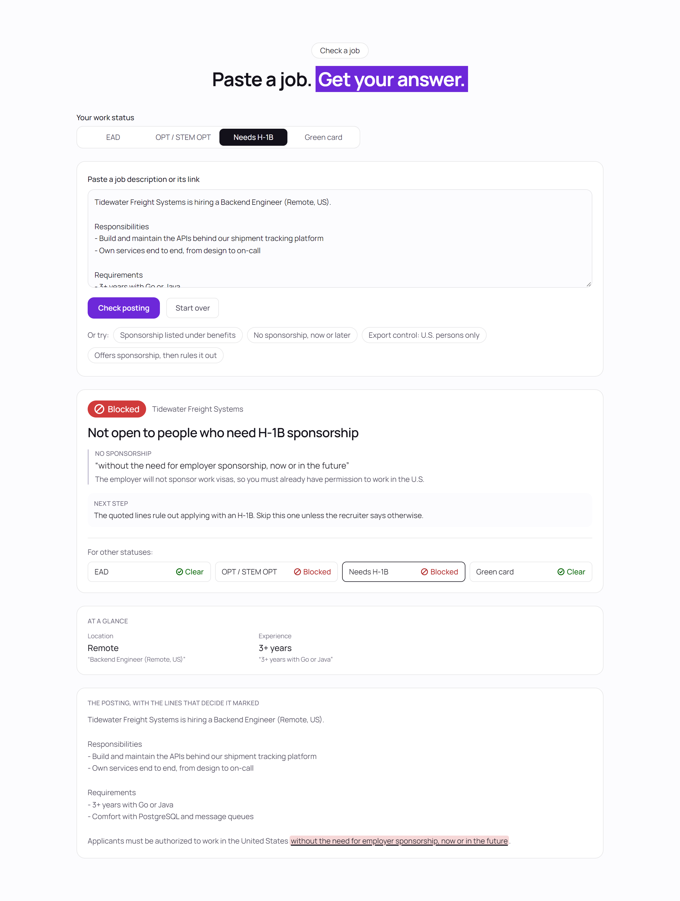
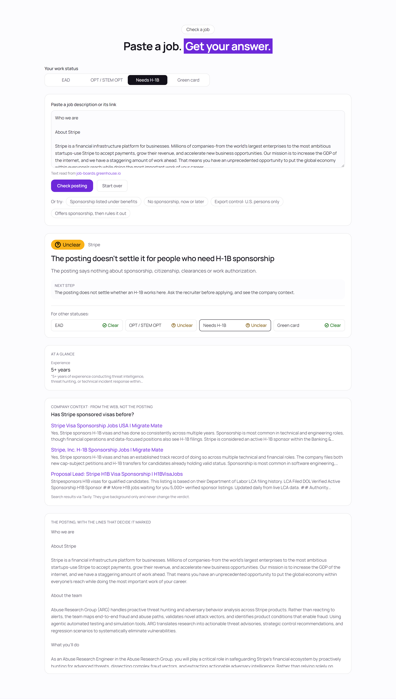
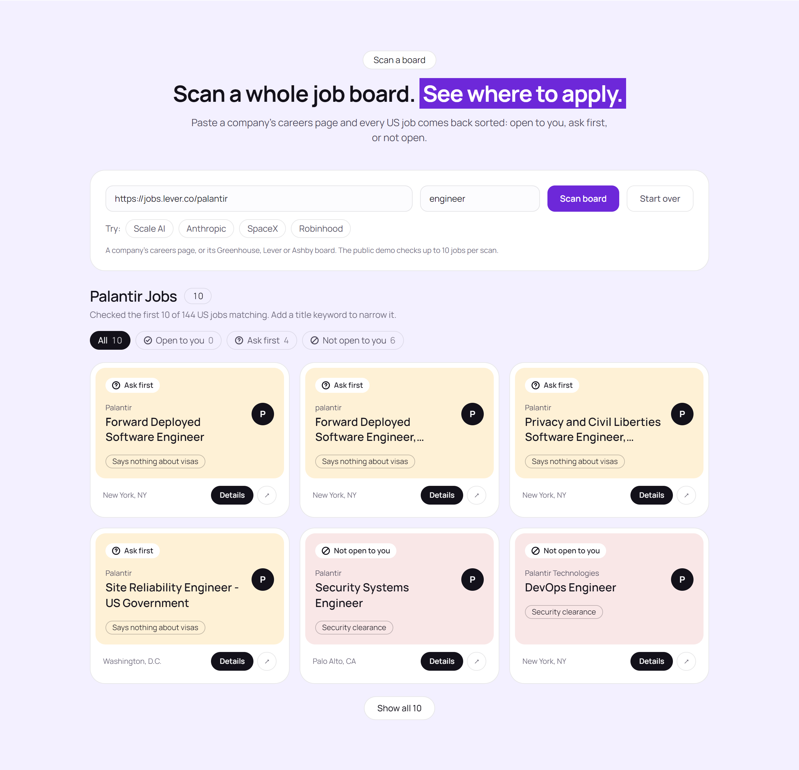
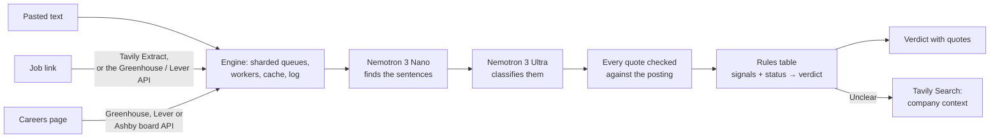
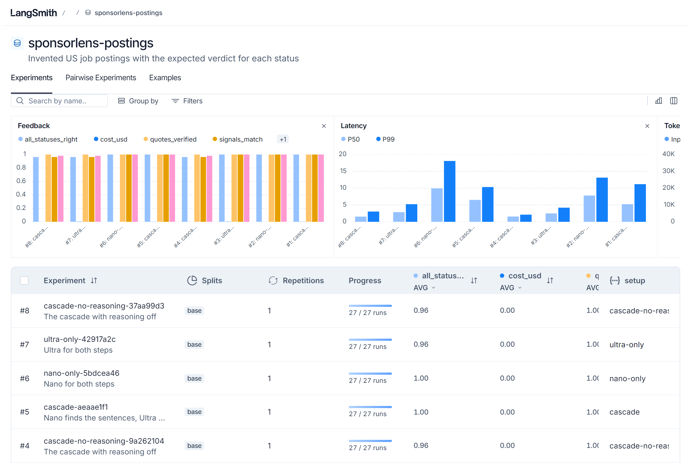
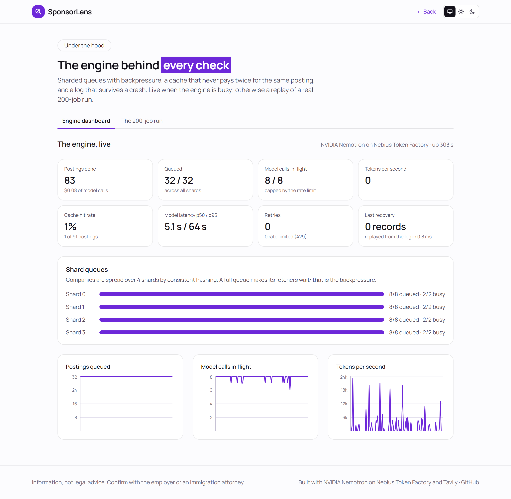
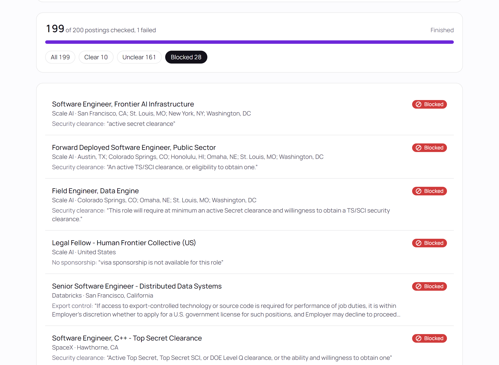
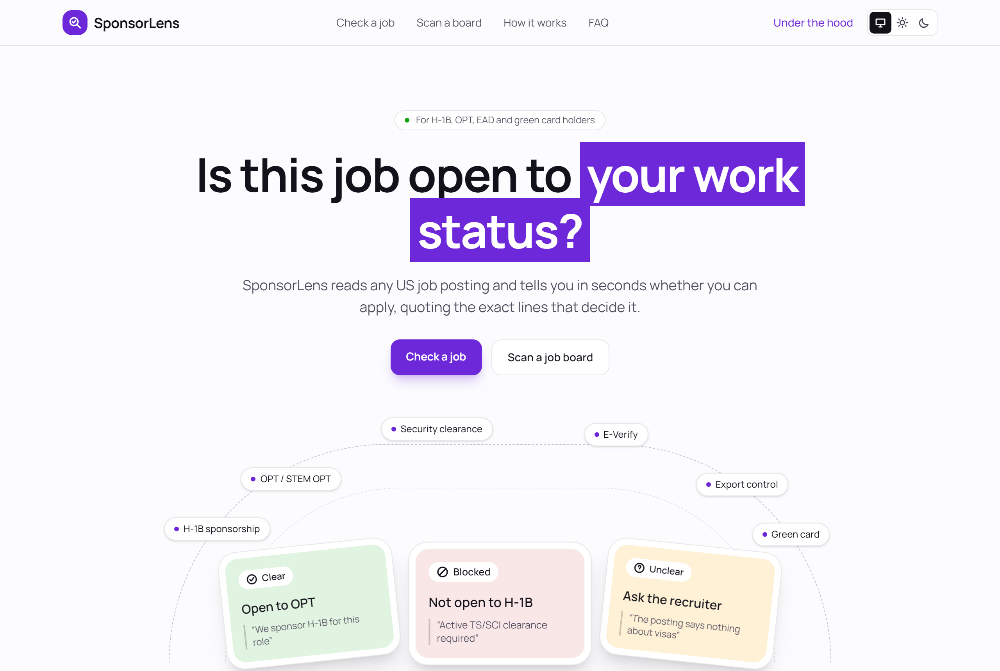
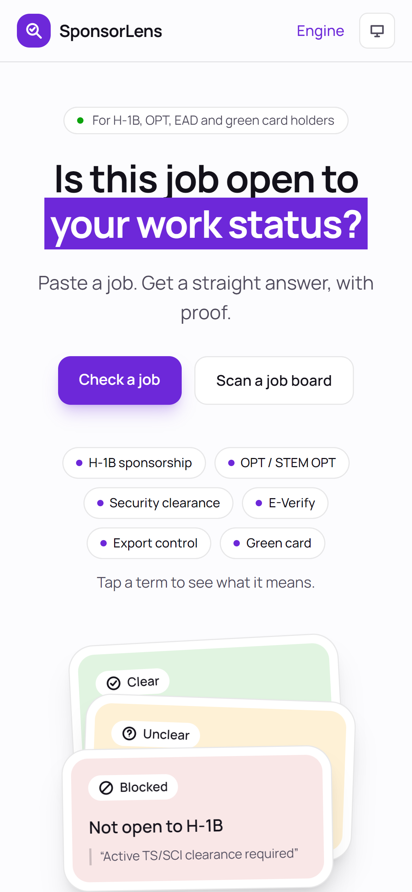

# SponsorLens

**Is this job open to me?** SponsorLens reads a US job posting and answers that for people on a work visa or permit. Each verdict quotes the exact lines from the posting that decide it.

**[Try it live](https://sponsorlens-web.onrender.com)** · **[Watch the demo](VIDEO_LINK)** · **[Accuracy dashboard in LangSmith](https://smith.langchain.com/public/95e912e9-08e0-40b1-b9ed-51ef301aaeed/d)**

Built solo for the Nebius x NVIDIA Global AI Hackathon with NVIDIA Nemotron on Nebius Token Factory and Tavily. Information only, not legal advice.



| Link | What it is |
| --- | --- |
| [sponsorlens-web.onrender.com](https://sponsorlens-web.onrender.com) | The live app. The server sleeps when idle, so the first check can take about a minute |
| [Demo video](VIDEO_LINK) | A walkthrough in under 3 minutes |
| [LangSmith dashboard](https://smith.langchain.com/public/95e912e9-08e0-40b1-b9ed-51ef301aaeed/d) | The accuracy experiments and every trace; no login needed |
| [docs/accuracy.md](docs/accuracy.md) | How accurate it is, and what the experiments showed |
| [docs/bench.md](docs/bench.md) | The engine benchmark |
| [FEEDBACK.md](FEEDBACK.md) | Notes on Nebius Token Factory and Nemotron from building this |

## The problem

Hundreds of thousands of people in the US work on OPT, an H-1B, an EAD or a green card. For them, the first question about any job is whether they're even allowed to take it. The answer is usually buried in the posting, in lines like these:

- "Candidates must be able to work in the US without sponsorship," in a legal footer.
- "Active Top Secret/SCI clearance," in the eighth requirement bullet.
- "Must be a U.S. person as defined in 22 CFR 120.62," which means export control.

Job boards don't filter on any of this. People read every posting carefully, or apply and hope.

## What it does

Pick your status (EAD, OPT, H-1B or green card), then do one of three things:

- **Check one job.** Paste the text, or a link from LinkedIn, Greenhouse, Lever, Ashby, Wellfound or most careers pages.
- **Scan a company.** Paste its careers page, and every US job on its Greenhouse, Lever or Ashby board comes back as a card.
- **See the verdict.** Each job gets one of three answers:
  - **Clear:** nothing in the posting stops you.
  - **Unclear:** it doesn't say, so ask the recruiter.
  - **Blocked:** the posting rules you out.

Every verdict comes with:

- **The deciding quotes, highlighted in the posting.** The code checks each quote word for word before it can count, so the model can't make up a reason.
- **A verdict for every status at once.** Switching status changes the answer instantly, with no new model call.
- **An "At a glance" card:** location, work mode, experience, education, salary and job type, each with its own quote.
- **Company context from Tavily when the answer is Unclear:** what the web says about the company's sponsorship history. It's shown beside the verdict and never changes it.





## How it works



1. **Nano reads, Ultra decides.** Nemotron 3 Nano scans the whole posting and copies out every sentence about visas, citizenship, clearances, export control or E-Verify. Nemotron 3 Ultra classifies only those sentences into seven signal types, each with the shortest exact quote and a plain reading.
2. **Quotes are verified in code.** A quote that isn't in the posting is sent back to the model once to correct. If it still isn't found, it's thrown out and the verdict falls back to Unclear.
3. **The rules decide, not the model.** A fixed table maps signals to a verdict for each status. Every rule has a unit test, and the same analysis serves all four statuses.

| Signal in the posting | EAD | OPT | H-1B | Green card |
| --- | --- | --- | --- | --- |
| Sponsorship offered | Clear | Clear | Clear | Clear |
| No sponsorship, now or in future | Clear | Blocked | Blocked | Clear |
| US citizens only | Blocked | Blocked | Blocked | Blocked |
| Security clearance required | Blocked | Blocked | Blocked | Blocked |
| Export control ("U.S. person") | Blocked | Blocked | Blocked | Clear |
| Citizens or permanent residents only | Blocked | Blocked | Blocked | Clear |
| Nothing said (E-Verify alone counts as nothing) | Clear | Unclear | Unclear | Clear |

The strictest signal wins. If a posting contradicts itself, such as offering sponsorship and then ruling it out in the footer, the verdict is Unclear for the statuses it affects.

## Where Nebius and NVIDIA are used

Every analysis calls NVIDIA Nemotron through Nebius Token Factory's OpenAI-compatible API. No other model provider is configured.

| Model | Job | Code |
| --- | --- | --- |
| `nvidia/NVIDIA-Nemotron-3-Nano-30B-A3B` | Finds the work-authorization sentences in the whole posting; reads the At a glance facts with reasoning off | [`analyzer.py`](backend/app/analyzer.py), [`glance.py`](backend/app/glance.py) |
| `nvidia/Nemotron-3-Ultra-550b-a55b` | Classifies those sentences into signals with exact quotes | [`analyzer.py`](backend/app/analyzer.py) |

[`llm.py`](backend/app/llm.py) is the Token Factory client:

- It uses JSON mode at temperature 0 and checks the spending cap before every call.
- It records tokens and cost from the catalog prices.
- If a reasoning reply uses up its token budget before writing any JSON, the call is retried with `chat_template_kwargs.enable_thinking=false`, which answers in seconds.

A live check costs about $0.0015 to $0.004. A live run of 200 real postings cost $0.30.

## Where Tavily is used

| Use | API | Code |
| --- | --- | --- |
| Reading a job from a link (LinkedIn, Wellfound, careers pages) | Tavily Extract, advanced depth | [`posting_link.py`](backend/app/posting_link.py) |
| Company sponsorship context when a verdict is Unclear | Tavily Search | [`company_context.py`](backend/app/company_context.py) |

Tavily Extract means the server never fetches an arbitrary URL itself, so a pasted link can't make it reach internal addresses. A page that doesn't look like a single job posting gets no verdict. A tester's Wellfound search link once returned a list of other jobs and got Clear, while the real job needed a clearance. The check that rejects such pages came from that.

## Accuracy, measured in LangSmith

The cascade is scored on 27 invented postings, each labeled for all four statuses. 12 of them are hard cases written after testing on real postings: a clearance buried in the requirements, export control cited by regulation number, "Visa sponsorship: Not available" as a header field, and "sponsor" used in its business sense.

| Setup | Right for all four statuses | Every quote verified | Cost for 27 |
| --- | --- | --- | --- |
| **Nano finds, Ultra classifies (the app)** | **27 / 27** | 27 / 27 | $0.045 |
| Nano for both steps | 27 / 27 | 27 / 27 | $0.007 |
| Ultra for both steps | 26 / 27 | 27 / 27 | $0.085 |
| The app's setup with reasoning off | 26 / 27 | 27 / 27 | $0.013 |

What the results show:

- **Reasoning off gave a false Clear,** the worst mistake for this audience. It missed a "without sponsorship" line in a footer, in both of two runs, so reasoning stays on.
- **Nano alone matched the cascade on this set at a sixth of the cost.** A larger dataset built from real postings would settle which setup to keep.



The [public dashboard](https://smith.langchain.com/public/95e912e9-08e0-40b1-b9ed-51ef301aaeed/d) has every experiment and trace. The findings are in [docs/accuracy.md](docs/accuracy.md), each posting's result is in [docs/accuracy-by-posting.md](docs/accuracy-by-posting.md), and the raw results are in [backend/results/](backend/results/).

## The engine

Checking 200 postings means about 300 model calls that take 6 seconds at the median and up to 100 seconds when Nemotron reasons at length. The engine underneath is built by hand on asyncio ([`backend/app/engine/`](backend/app/engine/)):

- **Bounded queues.** Each is written on two `asyncio.Condition`s, so a full queue pushes back on the fetchers instead of growing without limit.
- **A worker pool** with a global semaphore set to Token Factory's measured rate limits, plus retries with full-jitter backoff on 429 and 5xx errors.
- **Four shards on a consistent-hash ring** (64 virtual nodes each), routed by company. One company flooding the engine can only fill its own shard.
- **A sharded LRU cache with single-flight.** The key is the content hash plus the prompt version and model IDs. Ten copies of a posting arriving together make one model call.
- **An append-only log with group commit** (fsync about every 100 ms), replayed on startup. Kill the server mid-batch and it resumes, and no finished posting goes back to the model.
- **A live dashboard,** streamed over server-sent events: queue depth per shard, calls in flight, tokens per second, latency percentiles and retries.





Benchmark ([docs/bench.md](docs/bench.md)): the real engine on a model that replays the live run's latencies, three seeds each.

| Measure | Result |
| --- | --- |
| 1 → 16 workers | 106 min → 7.2 min for 200 postings, almost linear |
| The same 200 again, cache warm | 0.2 s and no model calls, against 13.2 min cold |
| 200 submissions of 20 distinct postings | 39 model calls instead of about 390 (single-flight) |
| One company floods with slow postings | Others get verdicts about 20% sooner on 4 shards than on 1 |
| Price of that isolation | About 30% slower on an even load; `SHARDS=1` where throughput matters more |
| Live run, Oct 27 | 200 real postings from 20 companies, 12.5 min, 303 calls, $0.30 |

### Design notes

- **asyncio, not threads.** The work is almost all waiting on the model, so a few hundred concurrent waits cost next to nothing on one event loop. The queue, pool and cache are written by hand to show backpressure and single-flight explicitly. The cache's critical sections never await, and they use a `threading.Lock`, so it stays correct if workers later move to threads.
- **Sharding in one process.** The shards model a multi-node design, where each node owns its queue, and they cap how much of the engine one company can take. The benchmark shows the price, and the fix would be letting idle workers take work from a busy shard.
- **The status isn't in the cache key.** The model only extracts signals, and the rules table applies the status. So one cached analysis answers every status, and changing the prompt or a model invalidates the cache automatically.
- **Posting text is never stored.** The log holds sources, titles and quoted signals, and a single check is never written to disk at all.

## The public demo

[sponsorlens-web.onrender.com](https://sponsorlens-web.onrender.com) runs on Render's free tier:

- **Waking up:** the API sleeps when idle and takes about a minute to wake. Meanwhile the site shows a recorded run.
- **Spending limits** keep it from spending credits without bounds:
  - a daily dollar cap checked before every model call;
  - an hourly request limit shared by all visitors;
  - board scans capped at 10 jobs each (`SCAN_LIMIT`).
- **The 200-job batch** is replayed from the recorded live run rather than started fresh. Run it locally to start your own.
- **End date:** after judging ends on Dec 15, 2026, the demo stops making paid calls and keeps showing its recordings.

It works on desktop and phone, in light and dark themes.

<p>
  
  &nbsp;
  
</p>

## Run it locally

You need [uv](https://docs.astral.sh/uv/) and Node.js 20 or newer.

```bash
cp .env.example .env              # add NEBIUS_API_KEY and TAVILY_API_KEY
cd backend
uv sync
uv run uvicorn app.main:app --reload          # API on :8000
```

```bash
cd web
npm install
npm run dev                                   # web app on :5173
```

To try the engine without a key, set `MODEL_BACKEND=fake`: it uses a keyword-based fake model and costs nothing. Under the hood → The 200-job run starts a batch from 20 preset companies, and Under the hood → Engine dashboard shows it running.

| Command (from `backend/`) | What it does | Cost |
| --- | --- | --- |
| `uv run pytest` | 235 tests on the fake model | Free |
| `uv run python -m scripts.eval` | The 15 core postings on the real models | About $0.10 |
| `uv run python -m scripts.experiment --setup cascade nano-only` | LangSmith experiments; needs `LANGSMITH_API_KEY` | $0.01 to $0.09 per setup |
| `uv run python -m scripts.rehearse` | 200 fake jobs; watch the queues fill and drain | Free |
| `uv run python -m scripts.kill_test` | Kills the server mid-batch, restarts it, checks nothing is redone | Free |
| `uv run python -m scripts.bench` | The benchmark, about 10 minutes | Free |

From `web/`: `npm test` runs 27 Vitest unit and component tests. `npm run test:e2e` runs 14 Playwright tests on desktop and phone sizes against the API on the fake model.

### Deploy

[`render.yaml`](render.yaml) deploys the API as a Render free web service and the web app as a static site, for $0. In Render, choose New → Blueprint, pick this repo, and enter `NEBIUS_API_KEY` and `TAVILY_API_KEY` when asked.

## Job data and privacy

- **Board data:** scans read the public, key-free job board APIs of [Greenhouse](https://developers.greenhouse.io/job-board.html), [Lever](https://github.com/lever/postings-api) and [Ashby](https://developers.ashbyhq.com/docs/public-job-posting-api). They read only published US jobs and link every verdict to the original posting.
- **Pasted text** is held in memory only while it's being analyzed, and is never logged, stored or sent to LangSmith.
- **Test data:** the test and evaluation postings are invented.

## What's next

- **A wider scope.** Testers asked for more than work authorization: remote or location limits, degree requirements and pay, in the same quote-backed way. The At a glance card is the first step.
- **A larger accuracy set** labeled from real postings, to decide between the cascade and Nano alone.
- **Work stealing between shards,** to keep the isolation without the throughput cost.
- **Per-visitor rate limits** and a hosted database for the log, so the demo survives restarts.
- **A browser extension** that shows the verdict on the job page itself.

## License

[MIT](LICENSE)
