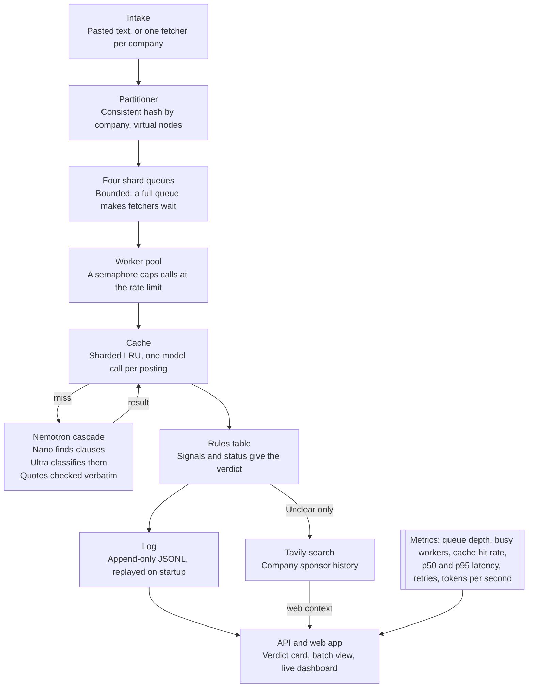

# SponsorLens: Phased Build Plan

Oct 23, 2026 · Himani Agrawal

> Copy of the Claude Doc [SponsorLens: Phased Build Plan](https://claude.ai/artifact/9eERAH6HMeyosCvfScbqU8), exported Oct 23, 2026. The two drawings in the doc appear here as a table and a Mermaid diagram.

## Goal and scope

SponsorLens ships by Thu Oct 29 as a hosted web app. It reads a US job posting and returns a verdict for the reader's work-authorization status, quoting the posting as evidence. It also runs 200 real postings through a concurrent pipeline with a live dashboard.

- **Track:** Best Apps and Agents, plus the $3,000 Best Use of Tavily prize through a runtime Tavily call.
- **User:** an international job seeker in the US (EAD, OPT or STEM OPT, H-1B, green card) who wants to know from the posting itself whether a job is open to them.
- **Priority:** a portfolio piece for AI engineer and FDE roles. When time runs short, product polish is cut before engine depth, tests or benchmarks. With about 25,000 entries, most judges will see only the video, so it gets a full phase.
- **Done means:** a stranger opens the demo URL, picks a status, pastes a posting, and understands the verdict and its evidence without instructions.
- **Cut on purpose:** accounts and saved profiles, a browser extension, a second server node, non-US rules, and LinkedIn or Indeed data.

| Area | Original plan | This plan | Why |
| --- | --- | --- | --- |
| Time | About 35 hours | 30 hours, solo | Your estimate |
| Judging | Video on the last day | Video gets 5 hours and opens on the live dashboard | About 25,000 entries; most judges see only the video |
| Verdict | One verdict for everyone | One verdict per status, chosen from a dropdown | The same clause blocks OPT but not EAD |
| Verdict logic | Ultra judges the fit | The model extracts quoted signals; a fixed rules table maps signals and status to a verdict | Deterministic, unit-testable, and the cache works across statuses |
| Batch source | Tavily search; job-board APIs first to cut | Greenhouse public API, as core; Lever is a stretch goal | Real postings from an authorized source |
| Tavily | Find postings | Add company sponsorship context to unclear verdicts | Supplies a signal the posting lacks |
| Engine | threading.Condition and worker threads | asyncio.Condition and worker tasks | Matches your FastAPI experience; threads become a stretch goal |
| Hosting | A paid always-on instance with a disk | $0: Render free tier only (sleeps when idle) | Judges mostly watch the video; the hosted demo only needs to work |
| Log | Hash and verdict only, which blocked resume | Append-only JSONL file with group commit; resume re-fetches by source | Fixes the resume conflict |
| Schedule | Seven days | Seven phases, each with an hour budget and a gate | A missed gate shows slippage the same evening |

## Decisions

These were settled in planning on Oct 23. Revisit one only when a phase gate fails because of it.

| Decision | Choice |
| --- | --- |
| Statuses | EAD (no sponsorship needed now), OPT or STEM OPT, needs H-1B now or a transfer, green card holder. A dropdown with no account; the choice is kept in the URL |
| Geography | US postings and US rules only |
| Live batch source | Greenhouse Job Board API (public, no key; Lever is a stretch goal), US-located roles from a preset list of 10 to 20 companies |
| Eval fixtures | 15 invented postings with the expected signals and a verdict per status |
| Models | Nemotron 3 Nano finds candidate clauses; Nemotron 3 Ultra classifies and explains each one. Both through Token Factory only |
| Tavily | Runs on Unclear verdicts: searches the company's sponsorship history and shows cited results in a separate company context panel. It never changes the posting verdict |
| Concurrency | asyncio: a bounded queue on asyncio.Condition, worker tasks, and a global semaphore set to the Token Factory rate limit |
| Sharding | Kept: consistent hashing by company, one bounded queue per shard. The README says it models a multi-node design in one process |
| Cache | Sharded LRU. Key = hash of normalized text + prompt version + model ID; the status is not in the key. Single-flight per key |
| Log | An append-only JSONL file, written with group commit (records buffered, one write and fsync about every 100 ms) and replayed on startup. It holds job source, content hash and result; pasted text is never stored; resume re-fetches by source |
| Hosting | $0, Render only. The engine runs as a Render free web service (sleeps when idle, wakes in about a minute) and the web app as a Render static site. The free disk is wiped on sleep, so the hosted demo starts fresh after each one; crash and resume are shown locally and in the video |
| Frontend | React, Vite, Tailwind and Recharts, built and served by FastAPI as static files |

### Verdict rules

The model only finds and quotes signals. This table, written as code, turns signals into a verdict, so every rule has a unit test and switching the dropdown needs no new model call.

| Signal in the posting | EAD | OPT or STEM OPT | Needs H-1B | Green card |
| --- | --- | --- | --- | --- |
| Sponsorship offered | Clear | Clear | Clear | Clear |
| No sponsorship, now or in future | Clear | Blocked | Blocked | Clear |
| US citizens only | Blocked | Blocked | Blocked | Blocked |
| Security clearance required or to be obtained | Blocked | Blocked | Blocked | Blocked |
| Export control: must be a "US person" | Blocked | Blocked | Blocked | Clear |
| Citizens or permanent residents only | Blocked | Blocked | Blocked | Clear |
| Employer uses E-Verify | No effect | Positive note (STEM OPT needs it) | No effect | No effect |
| Nothing about work authorization | Clear | Unclear | Unclear | Clear |

The strictest signal wins, conflicting signals give Unclear, and Unclear triggers Tavily. The table is information, not legal advice; two edge cases are listed under Open items.

## Time budget

Seven gated phases fit 30 hours before the Oct 30 deadline. Each gate must pass before the next phase starts.

| Phase | Date | Hours | Gate |
| --- | --- | --- | --- |
| P0 Setup, first model call | Fri Oct 23 | 2 | /api/ping-model returns a Nemotron reply |
| P1 Verdict for one posting | Sat Oct 24 | 6 | 12 of 15 fixtures pass, no unverified quotes |
| P2 Engine core, first deploy | Sun Oct 25 | 6 | Tests pass; app live on Render free tier |
| P3 Intake, shards, cache, log | Mon Oct 26 | 4 | Survives a kill mid-batch, no repeat calls |
| P4 Web app and dashboard | Tue Oct 27 | 5 | A new user reads a verdict unaided |
| P5 Full deploy, benchmark | Wed Oct 28 | 2 | URL works on a phone; benchmark saved |
| P6 Video, README, submit | Thu Oct 29 | 5 | Devpost shows Submitted, not Draft |
| Buffer: fix, don't build | Fri Oct 30, morning only | — | Deadline 10:00am PDT; no edits after it |

The weekend carries 14 of the 30 hours (Fri to Sun), including the first deploy, before the workweek starts. Each evening, compare the hours spent with the phase budget, and record a short screen clip of the gate passing; Phase 6 edits those clips into the video.

### Cut order

A gate missed by 2 or more hours means cutting the next item below. The cuts take product scope first, because engine depth is what the portfolio shows. The per-IP limit and Lever are already cut, to make room for the free deploy and the video.

1. Per-shard dashboard charts: show totals; per-shard numbers stay in /metrics.
2. The two-model split: one Nemotron model for both steps.
3. Highlighted quotes in the posting text: show a plain list of quotes.

**Never cut:** the verified-quote verdict, the rules table, the Nemotron and Tavily calls, the bounded queue and worker pool, sharding, the cache with single-flight, the log with resume, the tests, the dashboard, the benchmark, the hosted demo and the submission.

## Tech stack

Python with FastAPI on one always-on server, with an engine built by hand on asyncio. The model calls wait on the network, so asyncio gets the same concurrency as threads with fewer ways to deadlock.

| Layer | Choice | Note |
| --- | --- | --- |
| Language | Python 3.11 or newer | asyncio.TaskGroup and faster asyncio |
| Server | FastAPI on uvicorn, one worker | The in-memory queues and cache must live in one process. SSE via sse-starlette |
| Engine | Hand-written: bounded queue, worker tasks, consistent-hash ring, sharded LRU with single-flight, append-only log with group commit | No queue or cache libraries; building them is the point |
| Model access | openai SDK (AsyncOpenAI) pointed at the Token Factory base URL | Model IDs and limits confirmed in Phase 0 |
| Structured output | Pydantic v2 | An invalid reply retries once |
| Job boards | httpx.AsyncClient, BeautifulSoup to strip HTML | Greenhouse returns HTML-escaped content |
| Search | tavily-python (AsyncTavilyClient) | Meets the Tavily bonus requirement |
| Web app | React, Vite, Tailwind, Recharts | FastAPI serves the build, so there is one deploy |
| Tests | pytest, pytest-asyncio, and a FakeModel with set latency and failure rates | Engine tests spend no credits |
| Benchmark | scripts/bench.py | Numbers feed the README and the video |
| Hosting | Render free web service and static site | $0. The engine sleeps when idle and starts fresh on wake |
| License | MIT | Allowed by the rules |

## Architecture

Every posting passes one bounded queue and one cache check before any model call. One FastAPI process; every stage reports to the metrics registry.

A cache hit skips the model entirely, and only Unclear verdicts call Tavily. Because the cache key leaves out the status, switching the dropdown reuses the same signals.

## Phase 0: Setup and first model call (Fri Oct 23, 2 hours)

This phase ends with a live Nemotron reply from your own endpoint, so every later phase builds on a working model path.

- [ ] Claim credits from the Nebius Builder Program and the FAQ promo code; note both balances in FEEDBACK.md
- [ ] Create Token Factory and Tavily API keys and keep them only in .env
- [ ] Create the public GitHub repo: MIT license showing in About, .env in .gitignore, a .env.example with blank values
- [ ] Scaffold backend/ (FastAPI), web/ (Vite, React, Tailwind), FEEDBACK.md and a README stub
- [ ] From the Token Factory catalog, record in FEEDBACK.md: exact model IDs for Nemotron 3 Nano and Ultra, prices, context sizes, rate limits, and whether JSON or structured output is supported
- [ ] Add GET /api/ping-model, which calls Nano through AsyncOpenAI and returns the reply and its latency

**Gate:** /api/ping-model returns a Nemotron reply locally, and the git history holds no keys.

## Phase 1: Verdict for one posting (Sat Oct 24, 6 hours)

This phase ends when at least 12 of 15 invented fixtures give the expected verdict for all four statuses, and no quote is unverified.

- [ ] Pydantic models: Signal (type from the rules table, exact quote, plain-language reading); Analysis (company, signals, model IDs, prompt version); Verdict (status, Clear, Unclear or Blocked, deciding signals, next step)
- [ ] Text normalizer: strip HTML, unescape entities, collapse whitespace, straighten curly quotes. Quotes are checked against this text
- [ ] Step 1, Nano: return the company name and every sentence that mentions sponsorship, citizenship, clearance, export control, E-Verify or work authorization. None found means "nothing about work authorization", and step 2 is skipped
- [ ] Step 2, Ultra: classify each candidate sentence into a signal type with a plain reading. Pydantic validates the JSON; one retry on an invalid reply
- [ ] Quote checker: every quote must appear in the normalized text. Failures are dropped and retried once; still failing gives Unclear
- [ ] Rules engine for the table above (strictest wins, conflict gives Unclear), with one unit test per row
- [ ] Tavily enrichment: on Unclear, search for the company's H-1B sponsorship history and return two or three cited results
- [ ] POST /api/analyze takes {text, status} and returns the verdict, signals and company context
- [ ] Write 15 invented fixtures covering every signal type, including three hard ones: sponsorship mentioned only under benefits, "ability to obtain a clearance", and contradictory clauses
- [ ] scripts/eval.py prints pass or fail per fixture and status; note prompt changes and model behaviour in FEEDBACK.md

**Gate:** eval.py shows at least 12 of 15 fixtures passing for all four statuses, with zero unverified quotes.

## Phase 2: Engine core and first deploy (Sun Oct 25, 6 hours)

This phase ends with a tested asyncio engine running 200 fake jobs, with queue depth visibly rising and falling under backpressure, and the bare app live on Render's free tier.

- [ ] BoundedQueue on asyncio.Condition: put waits when full, get waits when empty, close() for shutdown. It is hand-written rather than asyncio.Queue, so the mechanics are visible in the code
- [ ] WorkerPool: N worker tasks per queue, a global asyncio.Semaphore capping in-flight model calls at the rate limit, and a graceful drain (stop intake, finish in-flight jobs, exit)
- [ ] Retries: exponential backoff with jitter on 429 and 5xx replies, at most 3 tries, each counted in metrics
- [ ] Job lifecycle: queued, running, done or failed, with a timestamp per stage
- [ ] Metrics registry: counters, gauges and a latency histogram with p50 and p95; GET /metrics returns JSON
- [ ] FakeModel with configurable latency, failure rate and 429 rate, so tests and rehearsals cost nothing
- [ ] pytest-asyncio tests: put blocks when the queue is full; in-flight calls never exceed the cap; drain finishes in-flight jobs; 200 jobs finish within a timeout with no deadlock; injected 429s recover through retries
- [ ] Deploy the bare scaffold for free (about 1 hour): the FastAPI engine as a Render free web service and web/ as a Render static site, with secrets in Render environment variables

**Gate:** all tests pass, and /metrics during a 200-job FakeModel run shows queue depth reaching capacity and returning to zero, and the Render URL answers /health after waking from sleep.

## Phase 3: Intake, sharding, cache and log (Mon Oct 26, 4 hours)

This phase ends when a 200-posting batch survives a server kill mid-run and resumes without sending any finished job to the model again.

- [ ] Read the Greenhouse API terms; record what they allow in the README
- [ ] Fetchers, one task per company (Lever moves to the stretch goals): Greenhouse `GET boards-api.greenhouse.io/v1/boards/{token}/jobs?content=true` and Lever `GET api.lever.co/v0/postings/{company}?mode=json`, keeping US-located roles
- [ ] Choose 10 to 20 companies whose boards give at least 200 US postings in total; save them as the preset list
- [ ] Consistent-hash ring by company with virtual nodes: 4 shards, one BoundedQueue each. Fetchers wait on a full shard queue, which is the backpressure
- [ ] Sharded LRU cache with a lock per shard, and single-flight so identical concurrent postings make one model call. The same job listed in several cities is a real case of this
- [ ] JSONL log behind a small LogStore interface (append_batch, replay), so a Neon store can be added later without engine changes: job_submitted (job ID, batch ID, source, shard) and job_done (job ID, content hash, signals) records. A single writer task does group commit, writing buffered records and calling fsync about every 100 ms; a job counts as done only once its record is on disk
- [ ] Startup replay: rebuild the cache and the set of finished jobs; re-enqueue unfinished jobs by re-fetching their source; skip a half-written last line. The job ID makes replay idempotent
- [ ] POST /api/batch takes {companies, status} and returns a batch ID; GET /api/batch/{id} returns progress and results
- [ ] Tests: adding a shard moves only about 1/N of companies; 10 concurrent identical jobs make 1 model call; replaying the log twice gives the same state; killing the writer mid-buffer loses no job already reported done

**Gate:** kill the server mid-batch and restart it; the batch completes and the model-call counter shows no finished job was sent again.

## Phase 4: Web app and live dashboard (Tue Oct 27, 5 hours)

This phase ends when someone who has never seen SponsorLens can check a posting and follow a batch on the dashboard without help.

- [ ] Status dropdown at the top, kept in the URL. Changing it recomputes the verdict from the cached signals, with no new model call
- [ ] Check a posting: paste box, then a verdict card (Clear, Unclear or Blocked) with each deciding quote highlighted in the posting text, its plain reading beside it, and a next step
- [ ] Company context panel on Unclear verdicts, with Tavily source links, labeled as web context rather than the posting
- [ ] Batch view: pick the preset company list, start a run, and filter the results table by verdict
- [ ] Dashboard over SSE, updated twice a second: queue depth per shard, busy workers against the cap, cache hit rate, p50 and p95 latency, model calls and retries, tokens per second
- [ ] Wake screen and sample mode: the web app loads instantly and, while the engine wakes (about a minute), replays a saved batch under a visible banner; it does the same when credits or rate limits run out. The dashboard shows the last recovery: records replayed and time taken
- [ ] Footer disclaimer (information, not legal advice); every verdict links to its posting

**Gate:** one person new to the app checks a posting and explains the verdict back to you unaided.

## Phase 5: Deploy, limits and benchmark (Wed Oct 28, 2 hours)

This phase ends with a public URL that works on a phone over cellular data, and saved benchmark numbers for the README.

- [ ] Deploy the full app: push to GitHub and Render rebuilds the engine and the static site
- [ ] Limits: a global daily budget of model calls. Public batches use the preset list, so repeat runs are mostly cache hits. The per-IP limit is cut
- [ ] Ask on the Nebius Discord whether a usage cap and a sleeping demo (about a minute to wake) are acceptable
- [ ] Run scripts/bench.py on your laptop, since the free instance's small CPU share would distort the numbers, on the 200-posting preset: 1 worker against 8, cold cache against warm, 1 shard against 4 at equal total workers. Record wall time, p95, model calls and cost
- [ ] Let the engine sleep, then wake it, and confirm it starts cleanly while sample mode covers the wait

**Gate:** the URL works on a phone over cellular data, the engine wakes cleanly from sleep, and the benchmark results are saved in docs/bench.md.

## Phase 6: Video, README, feedback, submit (Thu Oct 29, 5 hours)

Among about 25,000 entries, the video and the Devpost page are what most judges see, so the video comes first. This phase ends when Devpost shows the entry as Submitted, the evening before the deadline.

- [ ] README: what it does, setup steps, where Nemotron and Token Factory are used (with links to the files), the architecture diagram, the rules table, benchmark results, and a design notes section (asyncio against threads, single-process sharding, the cache key choice)
- [ ] Video under 3 minutes, public on YouTube, no logos or copyrighted music, built from the clips recorded at each gate. Open on the payoff: the dashboard mid-run beside a verdict with highlighted quotes (0:00 to 0:15); the problem (0:15 to 0:35); one posting and a status switch (0:35 to 1:15); a 200-posting batch, a kill and recovery, then a warm-cache rerun (1:15 to 2:15); the stack, Nemotron on Token Factory, and the benchmark numbers (2:15 to 2:50)
- [ ] Finish FEEDBACK.md and paste it into the form
- [ ] Devpost form: description, tools (Nemotron 3 Nano and Ultra, Token Factory, Tavily), the Best Apps and Agents track, video link, repo and demo URL. Use a dashboard screenshot as the cover image and put a short GIF at the top of the README. Save the draft, then submit

**Gate:** Devpost shows Submitted, not Draft.

**Fri Oct 30, morning:** buffer only. The deadline is 10:00am PDT (noon Central), and nothing can be edited after it. Fix a broken link or a downed server; do not build.

## Stretch goals

Start these only after a phase finishes under its hour budget, in this order. Each one adds engineering depth for the portfolio.

1. Fault-injection controls on the dashboard: inject 429s or slow the model, then watch retries and backpressure respond live.
2. Neon free Postgres as a second LogStore, so the hosted demo keeps its log through sleep and every wake is a real crash recovery (about 1 hour; no engine changes).
3. A threaded backend behind the same queue interface, benchmarked against asyncio, with the GIL result written up.
4. Lever Postings API as a second job board.
5. Prometheus text format on /metrics.
6. A hot-shard view: the skew when one company dominates, and how virtual nodes spread it.
7. USCIS H-1B Employer Data Hub as a second company-context source beside Tavily.

## Rules checklist

Each row is a requirement from the official rules or FAQ, with the phase that must meet it.

| Rule | How SponsorLens meets it | Phase |
| --- | --- | --- |
| Runtime call to Token Factory with an NVIDIA open model | Every analysis calls Nemotron 3 Nano, and Ultra when clauses are found | 0 |
| No other provider for the NVIDIA model | Only the Token Factory base URL is configured | 0 |
| Public repo with an open-source license in About | MIT in the first commit; .env ignored; no keys in history | 0 |
| Original work, no third-party IP | Invented fixtures; real postings processed at runtime and never committed; no company logos | 1 |
| Tavily bonus | A runtime Tavily call on every Unclear verdict | 1 |
| Third-party data must be authorized | Pasted text, Tavily, and the Greenhouse public API after reading its terms; no LinkedIn or Indeed | 3 |
| Working demo URL, free until Dec 15 | Render free service with no login; it sleeps when idle, and the web app shows sample results while it wakes; limits plus sample mode; cap question on the Discord | 5 |
| README with setup and Nebius usage | Setup steps plus a Nemotron and Token Factory section | 6 |
| Demo video under 3 minutes | Public on YouTube, app running, no logos or copyrighted music | 6 |
| Written feedback on Token Factory and NVIDIA tools | FEEDBACK.md kept from Phase 0 | 6 |
| Submit before Oct 30, 10:00am PDT | Submitted the evening of Oct 29 | 6 |

Sources: [official rules](https://nebiusglobalaihackathon.devpost.com/rules) and [FAQ](https://nebiusglobalaihackathon.devpost.com/details/faqs), as read on Oct 23. The deadline matches the [Devpost listing](https://nebiusglobalaihackathon.devpost.com/).

## Risks

The biggest risk is time: 30 hours with no slack, so the evening gate check matters more than any single technical risk.

| Risk | Response |
| --- | --- |
| A phase overruns | Check the gate each evening; 2 or more hours behind means taking the next cut before starting the next phase |
| Judges only watch the video | The video gets 5 hours, opens on the live dashboard, and uses clips recorded at each gate |
| Token Factory credits run out | Claim both credit sources in Phase 0; use FakeModel for all engine work and Nano alone while tuning prompts; cache everything |
| Rate limits slow the batch | Set the global semaphore to the limit found in Phase 0; present backpressure and retries as features in the demo |
| The model invents a quote | The quote checker rejects it, retries once, then marks the verdict Unclear |
| Nemotron replies are not clean JSON | Use JSON or structured-output mode if Token Factory supports it; otherwise strip any reasoning text, parse, and retry once |
| Greenhouse terms forbid this use | Fall back to 200 invented postings, labeled as synthetic in the UI |
| One company dominates a shard | Virtual nodes on the ring; show the skew on the dashboard as a talking point |
| The engine is asleep when someone visits | The web app loads instantly and plays sample results while the engine wakes in about a minute; the README says so |
| Render's 750 free hours a month run out | Run only this one free service; a sleeping service uses no hours |
| The free disk is wiped when the engine sleeps | Expected: the hosted demo starts fresh after each sleep. Sample mode covers the wait, and crash recovery is shown locally and in the video |
| The server is killed mid-batch | Committed records replay on restart and unfinished jobs are re-fetched by source; on Render free this holds until the service sleeps |
| A verdict is read as legal advice | Disclaimer in the UI and README; every verdict shows its quotes and links to the posting |

## Submission checklist

Run this on Oct 29 and finish before the Oct 30 deadline of 10:00am PDT.

- [ ] Repo is public, MIT shows in About, and no API keys are in the code or git history
- [ ] README has setup steps, a Nemotron and Token Factory section, the architecture diagram and benchmark results
- [ ] Demo URL opens without a login and works on a phone
- [ ] Sample mode works if the live model is slow or credits run out
- [ ] Video is under 3 minutes, public on YouTube, with no logos or copyrighted music, and linked in the form
- [ ] Track is Best Apps and Agents
- [ ] Description explains the features and how the pipeline works
- [ ] Tools listed: Nemotron 3 Nano and Ultra, Token Factory, Tavily
- [ ] Feedback on Token Factory and the NVIDIA tools is complete
- [ ] Draft saved, then submitted; the entry shows Submitted
- [ ] Demo stays up and free through Dec 15, when judging ends

## Open items

Each of these is unconfirmed and is resolved in the phase shown.

- [ ] Exact Nemotron 3 Nano and Ultra model IDs, prices and rate limits in the [Token Factory catalog](https://tokenfactory.nebius.com/models) (Phase 0)
- [ ] Whether Token Factory supports JSON or structured output for Nemotron (Phase 0)
- [ ] Greenhouse API terms for this use (Phase 3)
- [ ] The 10 to 20 companies for the preset batch (Phase 3)
- [ ] Whether Render's free tier asks for a card (Phase 2)
- [ ] The Nebius Discord answer on demo usage caps (Phase 5)
- [ ] Rules edge cases: export rules may count asylee and refugee EAD holders as US persons, and H-4 EAD holders may later need sponsorship (Phase 1)
- [ ] Your timezone: the original plan used Central time (Phase 0)
